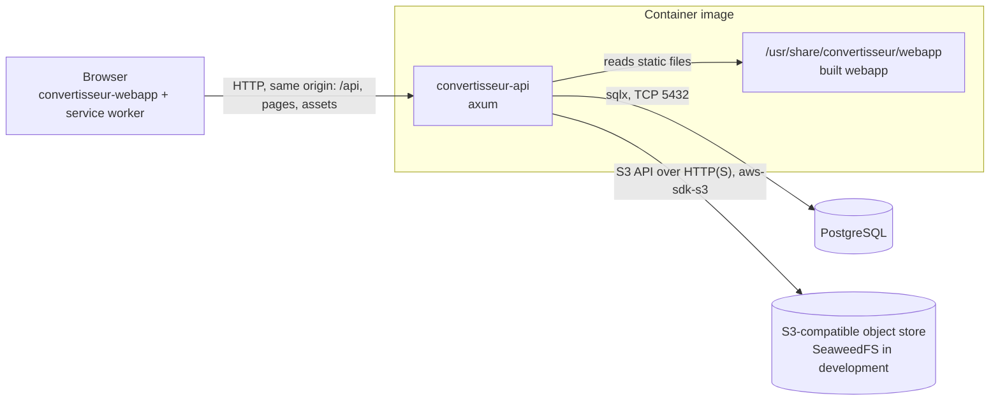
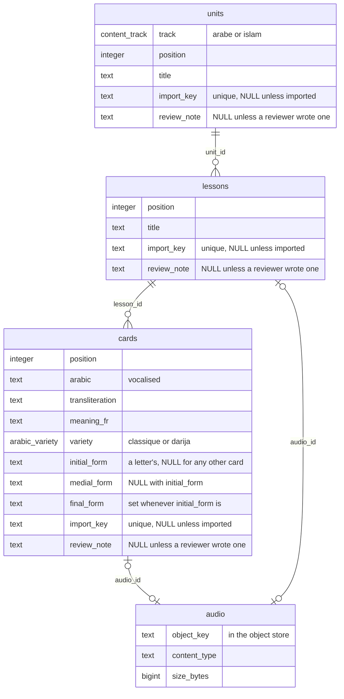
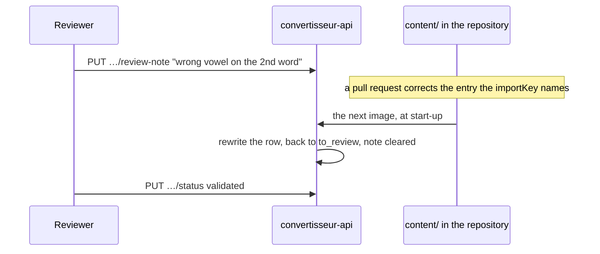
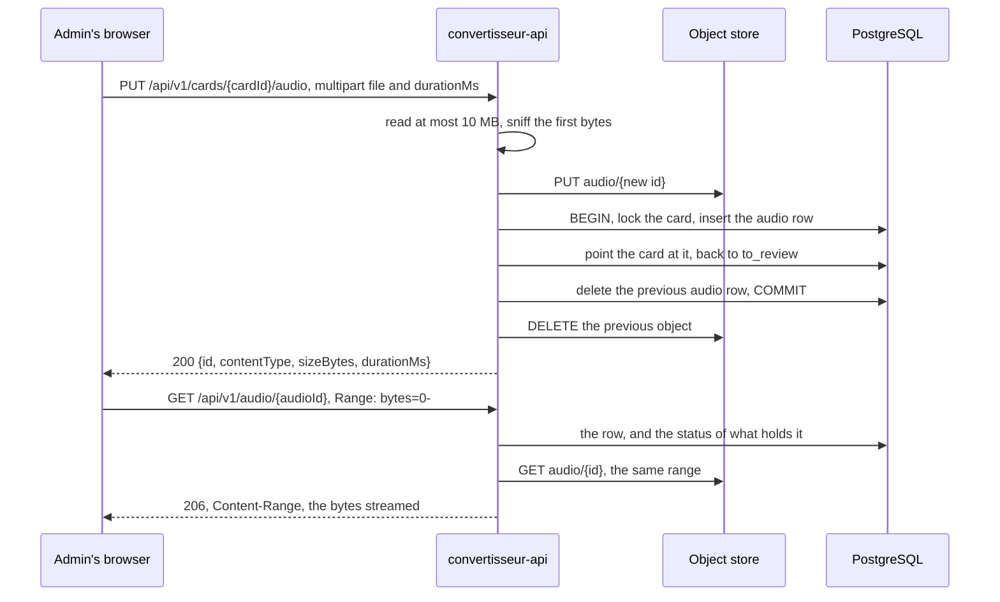
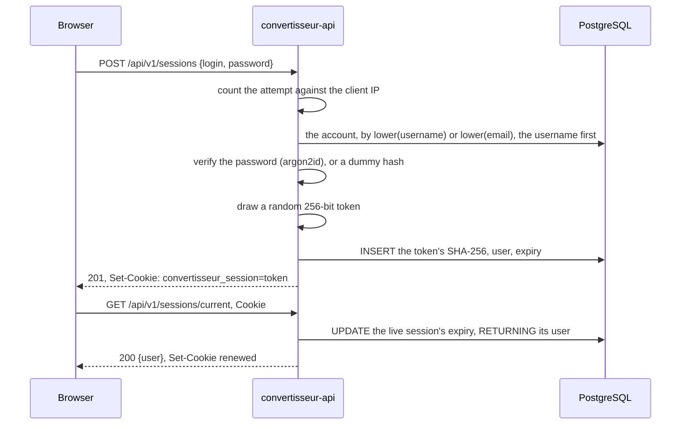
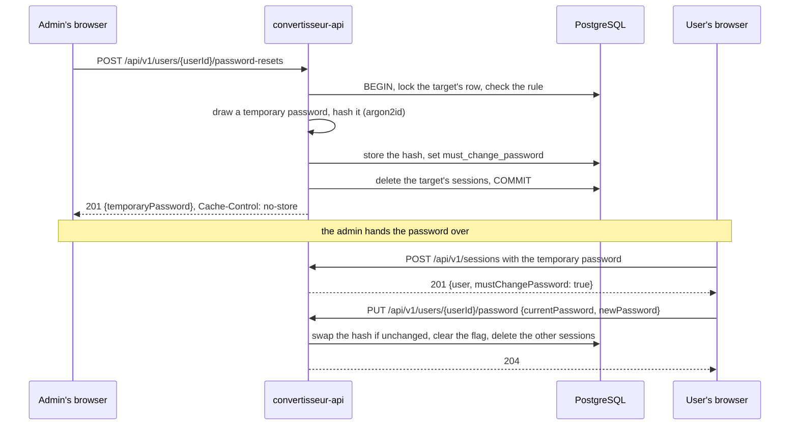
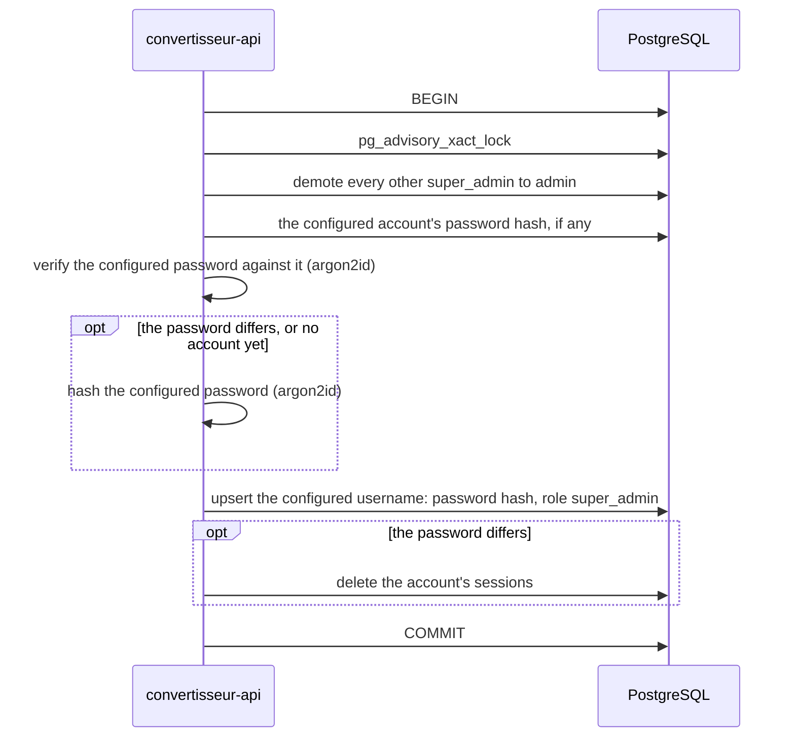

# Architecture

## Overview

Convertisseur is one HTTP server in front of a PostgreSQL database and an
S3-compatible object store. The server, [`convertisseur-api`](convertisseur-api/), answers the JSON API under
`/api` and serves the built [`convertisseur-webapp`](convertisseur-webapp/), a
React progressive web app, for every other path. Both ship in a single
container image.

## Components

### `convertisseur-api`

The Rust server: [axum](https://docs.rs/axum) with
[aide](https://docs.rs/aide) for the `OpenAPI` document, sqlx for PostgreSQL,
tokio for the runtime. One binary with two subcommands: `serve`, and
`healthcheck`, which probes `/healthz` of a server on the same host and is the
container's health check, since the runtime image has no shell or HTTP client.

On `serve`, it connects to PostgreSQL, applies the embedded migrations, runs
the super admin bootstrap, creates the object store's bucket if it does not
exist, syncs the starter content (see [The starter content](#the-starter-content)),
then listens. `SIGTERM` and `SIGINT` stop it
accepting connections and let in-flight requests finish before it exits.

It owns the whole URL space, split by path:

| Path | Answered by |
| --- | --- |
| `/api/v1/…` | The JSON API, versioned in its path and built with aide so that every operation is documented. Every failure is an `application/problem+json` document. A path under `/api` that matches no operation answers a `404` problem, never the webapp. |
| `/openapi.json`, `/docs` | The `OpenAPI` document generated from the code, and the Scalar reference that renders it. |
| `/healthz`, `/readyz` | Liveness, and readiness, which runs `SELECT 1` against PostgreSQL and looks up the bucket in the object store, both at once; its `503` names what does not answer. Outside the `OpenAPI` document. |
| anything else | A file of the built webapp, or its `index.html` when no file matches, so that the client-side router resolves deep links; a missing file under `/assets` answers `404` instead. Files under `/assets` are named by Vite after their content, so they are `immutable` for a year; every other file, `index.html`, the service worker and the manifest among them, is `no-cache`, so that a browser revalidates it and picks up a new build on its next load. |

Configuration comes from flags or environment variables, parsed once by clap
in [`config.rs`](convertisseur-api/src/config.rs). SQL lives in `.sql` files
under [`queries/`](convertisseur-api/queries/), loaded with `include_str!`.

### `convertisseur-webapp`

React and TypeScript, built by Vite into static files. TanStack Router maps
paths to pages. `vite-plugin-pwa` generates the web app manifest, a Workbox
service worker that precaches the build, and the PWA icons.

Every navigation first asks the API who is logged in
(`GET /api/v1/sessions/current`): the session cookie is `HttpOnly`, so the
server is the only one that knows, and the webapp keeps no copy of the session
of its own. A visitor without a session lands on `/login`, the login and
registration screen; a logged-in user is sent from there to `/`. An account
whose password was reset by an admin can reach `/password` only, one without
an email `/email` only (see [Accounts and sessions](#accounts-and-sessions)),
and the admin area under `/admin` is open to `admin` and `super_admin` alone. These
guards spare the user a page that would only fail: the server enforces the
same rules on every request. The admin area opens on `/admin/content`, where
staff write and review the learning content (see
[The review queue](#the-review-queue)), beside `/admin/users`.

`/admin/content` keeps its filters in its query string, each change
replacing the history entry rather than adding one: `status`, `note` (a
review note), `audio=missing` (cards without a recording) and `track`
narrow what it shows. It shows one of three things:

- **The tree**, by default: the tracks, their units and their lessons, each
  lesson with its cards and what is left to review. `unit` narrows it to one
  unit. The filters keep the lessons where the lesson, its unit or a card
  matches, and the counts beside them are computed in the browser from the
  lesson summaries (`GET /api/v1/lessons`), the units and the items with a
  note (`GET /api/v1/content-items`), loaded once.
- **One lesson's cards**, with `lesson`: in the lesson's order, filtered in
  the browser, with the previous and next lessons the filters keep, and the
  way to review the lesson, edit it or write a card in it.
- **The search results**, with `q`: units, lessons and cards from
  `GET /api/v1/content-items`, the latest edit first, `page` by page, each
  with the path of its unit and lesson.

Each item is edited on a page of its own,
`/admin/content/{units|lessons|cards}/{id}`, and written at
`/admin/content/{units|lessons|cards}/new`, which starts in the unit or
lesson its `parent` names and leads to the new item's page once it is
created. An item's page links up to its track and its unit or lesson, and a
unit's or lesson's page down to its lessons or cards. A page opened from the content page carries its filters in its
history state, so that its way back, and deleting the item, return to the
very entry it came from, filters and scroll included, unless that entry
showed the lesson just deleted; opened from a link, it leads to the tree
unfiltered.

Learners start on `/`, which shows both tracks; `/tracks/{track}` draws a
track's units and their lessons as a path, and
`/tracks/{track}/lessons/{lessonId}` shows a lesson's cards one at a time,
with the transliteration and the meaning hidden until asked for, and a letter's
shapes in a row under it (see [The forms of a letter](#the-forms-of-a-letter)).
The lesson offers `/tracks/{track}/lessons/{lessonId}/exercise`, a
multiple-choice exercise on the same cards (see [Exercises](#exercises)), from
its first card and at its end, and the track's map offers it under every lesson
that has one. Each page shows where the learner stands: `/` resumes the last
lesson touched, or sends to its exercise or to the next lesson; the map marks
each lesson done, in progress, new or locked, with its best score; a lesson
opens on the first card not seen yet (see
[Progress and the lock](#progress-and-the-lock)). These pages
load their data in the router's loaders, so a lesson the API does not serve
renders the page not found rather than an empty screen.

The interface is in French. The visual identity lives in CSS custom properties
in [`styles.css`](convertisseur-webapp/src/styles.css), with a light and a dark
set switched by `prefers-color-scheme`.

### `content/`

The starter content: one YAML file per unit, under the directory of its track.
[`build.rs`](convertisseur-api/build.rs) lists the files and
[`sync/catalogue.rs`](convertisseur-api/src/sync/catalogue.rs) embeds them
with `include_str!`, so they are part of the binary; nothing reads the
directory at run time.

### `assets/`

The logo, [`logo.svg`](assets/logo.svg), and Vite's public directory: its files
are copied as-is to the root of the webapp build. The favicon and every PWA
icon are rasterised from `logo.svg` at build time.

### PostgreSQL

The store of everything structured, and the source of truth for who may read
what. The server creates and migrates its schema itself.

### Object store

Any S3-compatible service holds the bytes of uploaded media, in one bucket,
under keys the server generates; PostgreSQL holds what they belong to. Local
development and CI run [SeaweedFS](https://github.com/seaweedfs/seaweedfs) with
its S3 gateway. Browsers never reach it: the server reads an object and streams
it back after its own permission checks. The decision and its trade-offs are
recorded in
[ADR 0001](docs/adr/0001-store-media-in-an-s3-compatible-object-store.md).

The server sees it through the `ObjectStore` trait in
[`storage.rs`](convertisseur-api/src/storage.rs): check, put, get with an
optional byte range, delete. `S3Store` implements it over the S3 API;
`MemoryStore` keeps objects in a map for the tests that do not exercise S3. A
contract test runs the same checks against both, the S3 one against the
SeaweedFS of the development stack, in a throwaway bucket.

## State and persistence

Migrations live in [`convertisseur-api/migrations/`](convertisseur-api/migrations/),
are embedded in the binary with `sqlx::migrate!`, and run at every start-up;
sqlx records each one and refuses to start when an applied migration has
changed.

`users` holds the accounts: a username, unique case-insensitively through an
index on `lower(username)`; an `email`, unique case-insensitively through an
index on `lower(email)`, and `NULL` on an account that has not set one, the
super admin the bootstrap creates or a row older than the column; an argon2id
password hash in PHC string format;
a `role` of the `user_role` enum, `user`, `admin` or `super_admin`;
`must_change_password`, set by an admin's password reset; and
`last_active_at`, the last time one of its sessions was opened or used.

`sessions` holds the logged-in sessions: the SHA-256 of the session token, the
user it belongs to, and when it expires. Deleting a user deletes its sessions.

`card_views` holds the cards each account has seen, with when it first and
last saw each; `exercise_results` holds each account's best exercise result
per lesson: the questions answered right the first time and the questions
asked, when that score was reached, when the exercise was first passed, and
the last attempt. Deleting the account, the card or the lesson deletes its
rows.

The learning content is a tree of three tables:

- **Every unit, lesson and card carries its review**: a `status` of
  `to_review` or `validated`, `created_by` and `updated_by`, and
  `validated_by` and `validated_at` while it is validated. The author columns
  are set to `NULL` when the account is deleted; the content stays.
- **Positions are 1-based and dense among siblings**: the units of a track,
  the lessons of a unit, the cards of a lesson. A `UNIQUE (parent, position)`
  constraint, deferred to the end of the transaction, lets an insertion, a
  move or a deletion shift the siblings it passes.
- **A recording is an `audio` row**, held by one card or one lesson through
  its `audio_id`. The row holds the key of the object in the object store,
  `audio/<the row's id>`, its content type, its size, its length when known,
  and who uploaded it.
- **A row created by the content sync carries its `import_key`**, the path
  of keys of its entry in `content/`, unique in its table; a row written in
  the admin area has none.
- **A `review_note` is what a reviewer reports about a row**, up to 2000
  characters, on any unit, lesson or card.
- **`content_items` is a view** over the three tables, in the shape of the
  review list: kind, track, title, parent title, status, last edit, import
  key, review note and the ids of the unit and of the lesson an item
  belongs to.

## Content and its review

Staff write units, lessons and cards in the admin area; a reviewer, any
`admin` or the `super_admin`, validates them. The rules, in
[`content.rs`](convertisseur-api/src/content.rs):

- **New content starts `to_review`, and any edit of its content sends it back
  there**, by whoever makes it: the `UPDATE` resets the status and the
  validation in the same statement, when a content field (title, Arabic,
  transliteration, meaning, variety, track) differs from the stored row
  (`IS DISTINCT FROM`). Saving a row unchanged keeps its validation.
  Moving or reordering a row, within its parent or to another, changes only
  its place: it keeps its status and validation, and `updated_by` and
  `updated_at` still record the move. The siblings it shifts keep their
  status.
- **Validating needs no second person.** Any admin validates, the author
  included; setting the status a row already has changes nothing, so the
  first validator and time stay.
- **Every write runs in one transaction under one advisory lock**, which
  serialises the shifting of positions across concurrent editors. Content is
  written by a few staff members, so one lock for all of it costs nothing.
- **A unit with lessons or a lesson with cards is not deleted**: the request
  answers `409` `not-empty`, and its children have to be moved or deleted
  first. A deletion never takes more than the row named.
- **An imported row's text and place belong to the content files.** Its
  `PUT` and `DELETE` answer `409` `imported-content`, whatever they would
  change, so that no edit is made in the admin area that the next sync would
  undo. Its status, its recording and its review note stay open, and so do
  its children written in the admin area: a card added to an imported lesson
  is edited, moved and deleted like any other.
- **A review note is not a status.** `PUT …/review-note` writes or clears it
  on any row, imported or not, and leaves the status alone: a reviewer who
  wants the row hidden again sends it back to review as well.
- **The admin endpoints are for staff alone.** Every endpoint of `/units`,
  `/lessons`, `/cards` and `/content-items` takes `RequireRole<Admin>`, and
  shows content whatever its status. Learners read through their own
  endpoints, described below.

The review list (`GET /api/v1/content-items`) spans the three kinds, the most
recently edited first, filtered by status, track, kind, text and presence of
a review note. Its `statusCounts` count each status under the other filters,
and its `reviewNoteCount` the rows with a note, for the filters' badges. Each
item carries its `importKey` and its `reviewNote`, so that the list of notes
is also the list of entries of `content/` to correct, and its `unitId` and
`lessonId` locate it in the tree. The text search also matches the title of
an item's parent, a lesson by its unit and a card by its lesson. The search
compares through `content_search_key`, a SQL function that lowercases and
strips the Arabic short vowels, other diacritics and the tatweel, so `شكرا` finds `شُكْرًا`.

## The review queue

`/admin/content?status=to-review`, where `/admin/review` leads, lists the
lessons a reviewer has something to do in, by track and unit, each with the
cards left to review and a way to review it; `audio=missing` lists them by
the cards without a recording instead.
`/admin/review/lessons/{lessonId}` reviews one of them: on a screen under
1024px wide, card by card and full screen, without the admin bar, whose
place the card needs; above, every card on one page, beside the admin
sidebar. The endpoints,
in [`api/content/review.rs`](convertisseur-api/src/api/content/review.rs),
take `RequireRole<Admin>` like the rest of the content:

- **`GET /api/v1/lessons` lists lesson summaries in the order of the
  tracks**: units by track and position, lessons by position. Each carries
  its unit and how its cards stand: validated, flagged, to review and
  without a recording. `pendingReview=true` keeps the lessons where the
  lesson, its unit or a card is to review; `missingAudio=true` the lessons
  with a card without a recording, whatever their status; `unitId` the
  lessons of one unit. Every page also gives `itemsToReview`, the units,
  lessons and cards to review, flagged or not, and `cardsWithoutAudio`, for
  the navigation's badge.
- **A flagged card is a card to review with a review note**, not a status of
  its own. Flagging writes the note and sends a validated card back to
  review; validating a flagged card clears its note.
- **A lesson's recording is optional**: learners are offered it only when it
  exists. "Without audio" counts cards alone; the review page still lets the
  reviewer record the lesson's.
- **`GET /api/v1/lessons/{lessonId}/cards` lists a lesson's cards** in order,
  whatever their status, in the shape of `GET /api/v1/cards/{cardId}`.
- **`POST /api/v1/lessons/{lessonId}/card-validations` validates the cards it
  names** that are to review without a note, in one transaction under the
  content lock. Flagged cards stay to review and validated ones keep their
  first validation. An id that is not a card of the lesson answers `422`
  `card_not_in_lesson` and validates nothing.
- **"Previous" and "next" lesson move among the lessons left to review**, in
  the order of the tracks, so that a reviewer goes from one task to the next
  without passing lessons with nothing to do.

## What learners see

Any logged-in account reads the content through `/api/v1/tracks`, in
[`api/tracks.rs`](convertisseur-api/src/api/tracks.rs): the two tracks with
their units and lessons, one track, and a lesson with its cards. These
endpoints take `Authenticated`, so an account waiting for a password change
gets the same `403` as everywhere else.

- **A unit, lesson or card is visible when it and every row above it are
  validated.** A validated lesson in a unit to review is hidden, and so are
  its cards. The rule lives in the SQL under
  [`queries/tracks/`](convertisseur-api/queries/tracks/) and in the
  recording lookup, which join up to the unit and test every status.
- **Hidden content does not exist for learners.** It is left out of the
  outline, and a lesson that is hidden, or that is not in the track the path
  names, answers `404`, like an unknown id.
- **Order is the staff's**: units by position in their track, lessons in
  their unit, cards in their lesson. The responses carry no position; the
  order of the arrays is the order, and the webapp numbers what it shows, so
  that a hidden unit leaves no gap in "Unité 1, Unité 2".
- **The endpoints serve the content with where the account stands in it.**
  Each lesson of the outline carries `hasExercise`, `locked` and its
  `progress`: the cards seen, the last one seen, the exercise result. A
  lesson carries its result, and each card whether the account has seen it.
  A locked lesson answers `403` `lesson-locked`.

## Exercises

An exercise asks questions about the cards of one lesson, in
[`quiz.ts`](convertisseur-webapp/src/lib/quiz.ts), and the exercise page
asks them one at a time, with three or four choices each. It is built from
the lesson the page already loads; only its score reaches the server, which
takes it as sent (see [Progress and the lock](#progress-and-the-lock)).

- **Five kinds of question**: the Arabic of a card, pick its meaning; the
  meaning, pick the Arabic; for a letter of the alphabet, one of its initial,
  medial or final forms, pick the isolated letter; and for a card with a
  recording, the recording, pick the Arabic, or the recording, pick its
  meaning. On a letter, the meaning is its sound, and the page words the
  question that way.
- **A recording replaces the written prompt of the meaning**: a word with a
  recording is asked its meaning from the recording, never from its written
  Arabic, which it still offers as the choices of its other questions. A
  letter keeps its written prompt, since hearing a letter to pick its sound
  tests nothing.
- **Twelve questions, every card asked, never twice for one answer**: each
  card asks one question of a kind drawn among those it allows, then the
  cards ask their other kinds, one card at a time, until the exercise holds
  twelve. A card never asks two questions with the same answer: the kinds
  whose answer is the Arabic share their distractors too, so a second one
  would be the first asked again. A card thus asks at most two questions, its
  meaning and one whose answer is its Arabic. A lesson whose cards allow
  fewer asks them all; one of more than twelve cards asks each once. A card
  without a meaning, forms or recording asks nothing.
- **Two questions about one card never follow each other**, in the order
  drawn or once a missed question comes back.
- **The distractors are the other cards of the lesson**, up to three, drawn
  at random. A distractor never reads like the answer: two cards that share a
  meaning are never offered against each other, nor two that share their
  Arabic. A question needs three choices, so a lesson of fewer than three
  cards has no exercise, and neither the lesson nor the map offers one.
- **A question answered wrong comes back near the end**, its choices
  reshuffled, until it is answered right. The progress bar counts the
  questions answered right.
- **The grade counts the first try only**: the share of questions answered
  right the first time, as a percentage rounded down, from `gradeQuiz`. An
  exercise is passed from 90 %, so a grade that shows 90 % is always a pass.
  `gradeQuiz` is a pure function; the server, which records the result,
  applies the same 90 %.

## Progress and the lock

What an account has done is kept by the server, in `card_views` and
`exercise_results`, written through two endpoints in
[`api/progress.rs`](convertisseur-api/src/api/progress.rs) and read back with
the outline and the lesson. The lock and the state of each lesson are
computed at every read in [`progress.rs`](convertisseur-api/src/progress.rs);
nothing about them is stored.

- **A card is seen once the lesson shows it**:
  `PUT /api/v1/card-views/{cardId}` marks it, again at each showing, which
  moves its last time. A lesson is done when every card it shows has been
  seen, so cards added later make it in progress again, and it opens on the
  first of them.
- **An exercise attempt keeps the best score**:
  `POST /api/v1/exercise-attempts` takes the questions answered right the
  first time and the questions asked, and keeps the best share, a tie keeping
  the earlier one. 90 % passes, the rule of `gradeQuiz`, and a pass is never
  taken back, whatever later attempts or content changes.
- **A track is one path, its units then its lessons in order.** Its first
  lesson is open; each next one opens when the one before is open and its
  exercise passed, or has no exercise. Whether a lesson has an exercise
  follows `hasQuiz`, which [`exercise.rs`](convertisseur-api/src/exercise.rs)
  repeats; the cases in
  [`exerciseCases.json`](convertisseur-webapp/src/__tests__/exerciseCases.json)
  run against both. The two tracks are independent, and the lock applies to
  every account, staff included.
- **A lesson the account has started never locks again**: one where it has
  seen a card or sent an attempt stays open, so a lesson added or validated
  upstream does not take back what was reached.
- **The lock holds on the server**: reading a locked lesson, marking one of
  its cards seen or sending its exercise answers `403` `lesson-locked`, and
  the webapp shows the lesson as locked rather than a page not found.
- **Content changes follow the rows**: a card that is rewritten or moved
  keeps its id, so it stays seen; a card or lesson deleted takes its rows
  with it; a card sent back to review drops out of the counts until it is
  validated again, seen as before.
- **Writes do not hold up the page.** The webapp sends a card view without
  waiting for it; a write the server cannot be reached for is kept in memory
  and sent again with the next write or when the browser is back online. A
  refusal is not retried.

## The starter content

The units, lessons and cards a database starts with are written in
[`content/`](content/), reviewed in pull requests, and brought into the
database by the sync in [`sync.rs`](convertisseur-api/src/sync.rs), at every
start-up of `serve`. The files are the only source of what they hold: an
imported row follows them in text, place and existence, and the admin area
reviews it, records it and annotates it.

- **A file is one unit, its lessons and their cards, in order.** Units sort
  by file name within their track's directory. Every entry has a key unique
  among its siblings, and its full key is the path from the track:
  `arabe/darija/salutations/wach-rak`. A unit sets the variety of its cards;
  the `islam` track is in classical Arabic only.
- **Every file is checked before anything is written**: unknown fields,
  malformed or repeated keys, blank or non-Arabic `arabic`, a variety that
  does not fit the track, forms that are not those of the card's letter. One problem stops the start-up, and the error lists
  them all. A unit test runs the same checks on the files of the build.
- **The sync makes every imported row match its entry.** An entry no row
  carries the key of is created, `to_review`, authored by the super admin. A
  row whose text differs from its entry's (title, Arabic, transliteration,
  meaning, variety, forms, track) is rewritten, sent back to `to_review` with its
  validation cleared, and its review note is cleared too, since the change
  answers it. A row whose text matches keeps its status and note. A row whose
  parent or place differs is moved, keeping its status, as a move in the admin
  area does. A row whose key no entry has any more is deleted, with its
  recording.
- **Imported siblings take the order of the files; a row written in the
  admin area keeps its neighbour.** It stays right after the imported sibling
  it followed, or first when no imported sibling came before it, and rows
  that followed the same one keep their order among themselves. When that
  sibling leaves, it follows the previous imported one that stays.
- **A sync never deletes work done in the admin area.** When a unit or lesson
  gone from the files still holds a lesson or card written in the admin area,
  the sync fails and names each of them, rather than delete them with it.
- **One transaction, under the content lock**, for the whole sync: a failure
  leaves nothing half done, an admin's concurrent edit waits for it, and
  replicas starting together sync one after the other, the later ones finding
  nothing to change. The objects of the deleted recordings are deleted after
  the commit, like any other deletion's.
- **Every change is logged at `info`**, with its key: created, rewritten,
  note cleared, moved, deleted; then one `content synced` line counts what
  was created, updated, moved, deleted and left unchanged per kind. A row
  both rewritten and moved counts as updated, and a row that only shifts for
  a sibling created, deleted or moved counts as unchanged.

## The forms of a letter

A card of the alphabet carries, beside its isolated letter in `arabic`, the
shapes the letter takes at the start, in the middle and at the end of a word,
in [`letters.rs`](convertisseur-api/src/letters.rs). The lesson screen shows
them in a row, "Isolée · Début · Milieu · Fin", and the admin area shows them
read-only.

- **The forms are written out in the content files, not computed.** Each is
  the letter with the tatweel `ـ` on the side it joins: `بـ`, `ـبـ`, `ـب`.
  They follow from the letter, but written out they are reviewed like the
  rest of the text by a reader of Arabic, and they are what the screen
  shows, character for character.
- **The checks derive what is right from the letter.** A table of the
  letters sorts each by how it joins: both sides, which takes all three
  forms; the previous letter only (ا د ذ ر ز و, and أ إ آ ٱ ؤ),
  which takes the final form alone; or the end of a word only (ة ى), which
  takes the final form alone as well. Every form must be the letter with the
  tatweel in its place; forms on anything but a single letter of the table,
  the hamza `ء` included, are refused.
- **What cannot happen cannot be written.** `LetterForms` is either the three
  forms or the final one alone, so a medial form without an initial one, or
  an initial form without a final one, has no value to hold it; the YAML
  reader turns the three optional keys into one of the two, or into an error.
  The table holds three nullable columns with a check constraint allowing
  exactly those two shapes and none, rather than a JSON column the database
  could not check.
- **The API names the shape, so the webapp never guesses.** `forms` is
  `null` on a card without them, or an object whose `kind` is `joining`,
  `non_joining` or `word_final`. The last two carry the same final form; the
  API tells them apart from the letter, and the webapp says why the initial
  and medial forms are missing rather than leave the cells empty.
- **Only the content files write forms.** The admin area creates and edits
  cards without them: the alphabet is starter content, locked like the rest
  of it, so a card written by hand is vocabulary, and a letter added by hand
  would duplicate an entry of the files where the review of letters happens.
  A form changed in the files rewrites the card and sends it back to review,
  like any other change of its text.

## Recordings

A card or a lesson holds at most one recording, uploaded as a file or
recorded with the device's microphone in the admin area, and played back
through the API.

- **No transcoding: the file is stored as the browser made it.** Safari
  records MP4 with AAC, Chrome WebM with Opus and Firefox Ogg with Opus, and
  every current browser plays all three, as well as MP3 and WAV uploads. The
  server keeps the bytes, so it needs no media toolchain and loses no quality.
- **The type comes from the file, never from the client.** The first bytes
  must be those of MP3, MP4, Ogg, WebM or WAV (see
  [`audio.rs`](convertisseur-api/src/audio.rs)), and that type is the one
  stored and served; anything else is a `415` `unsupported-audio`.
- **The length is the server's when the file gives it cheaply, the browser's
  otherwise.** The server reads it from a WAV header or the last Ogg page.
  MP3, MP4 and WebM would take parsing the whole stream, so the browser sends
  the length it measured as an optional `durationMs` multipart part: the
  decoded length of the file, or for a recording the time between start and
  stop when the browser reports none (Chrome's `MediaRecorder` WebM decodes
  to `Infinity`). The server stores it only when it cannot read the length
  itself, a length it reads wins, and a value that is not a whole number
  from 1 ms to 10 minutes is a `422` `duration_invalid`. Without either, the
  length is `null`.
- **10 MB at most**, set by a body limit on the upload routes alone, a little
  above the file limit to leave room for the multipart framing, then checked
  on the file itself; past it, a `413` `too-large`.
- **No object without a purpose is left behind, and no row without its
  object.** The new object is written before the row that points at it and
  deleted again if the transaction fails; the previous object is deleted only
  after the commit that stops pointing at it. Removing a recording, or
  deleting the card or lesson that holds it, deletes the row and then the
  object. A failed object deletion leaves an orphan that nothing references
  and logs a warning; it never fails the request.
- **A new or removed recording is an edit**: the card or lesson goes back to
  `to_review`.
- **Playback goes through the API** (`GET /api/v1/audio/{audioId}`), which
  streams the object from the store. Any logged-in account plays the
  recording of a card or lesson learners see (validated, with every row above
  it), an `admin` plays any; anything else is a `404`, which says nothing of
  what exists. It honours a single
  `Range: bytes=…` with a `206`, which Safari needs to seek in an `<audio>`
  element, answers `Cache-Control: private`, and sends the stored type with
  `X-Content-Type-Options: nosniff`.
- **The microphone needs a secure context.** Browsers open it only on HTTPS
  pages, and on `http://localhost`. On anything else the admin area says so
  and offers the file upload; the same goes for a browser without
  `MediaRecorder` or a refused permission.

## Accounts and sessions

An account is a username, an email address and a password. Registration
creates a `user`; usernames are 3 to 32 characters among ASCII letters, digits,
`.`, `_` and `-`, emails pass the `validator` crate's format check, and
passwords are at least 12 characters, the rule the super admin's password
follows too. Registering does not log in: the webapp chains the two calls. The
login screen takes one field, the username or the email.

- **The browser holds an opaque token; the database holds its SHA-256.** The
  token is 32 random bytes, so a fast hash is enough, and a copy of the table
  yields nothing that can be replayed as a cookie.
- **A session lasts 30 days after its last use.** Each authenticated request
  moves the expiry 30 days ahead and renews the cookie's `Max-Age` to match.
  An expired session is refused at once, and an hourly task in the server
  deletes the expired rows.
- **Logout deletes the session** and clears the cookie. It answers `204`
  whether or not there was a session, so a retry is harmless.
- **A new super admin password closes that account's sessions.** The bootstrap
  verifies the configured password against the stored hash; when it no longer
  matches, it stores the new hash and deletes the account's sessions in the
  same transaction. The same password keeps the stored hash and the sessions,
  so a restart logs nobody out.
- **`login` names the account by its username or its email.** A username never
  holds an `@`, so the two cannot meet, except for the configured super admin's
  username, which the registration rules do not bind: when it is another
  account's email, the super admin wins, and that account logs in with its
  username. The body's `login` also reads as `username`, the name a page of an
  earlier build still open in a browser sends.
- **A failed login says nothing about the account.** An unknown username or
  email and a wrong password get the same `401`, and an unknown one is verified
  against a fixed dummy hash, with the same argon2 parameters, so that both take
  as long. The log line of a refusal names no username or email.
- **The email is a second login name, never a channel.** It is not verified and
  the server sends nothing to it. An account sets or changes its own with
  `PUT /api/v1/users/{userId}/email`; nobody else's, admins included. It is
  shown to the account itself and to admins in `/admin/users`, and to nobody
  else: the content's authors carry their username alone.
- **An account without an email is asked for one by the webapp.** Every page
  but `/email`, `/password` and logout sends it to `/email` until it sets one,
  as the forced password change does; the server answers it as any other
  account, since nothing it serves depends on the address.
- **Registration and the email change tell whether an email is taken**, with a
  `409` `email-taken`, as registration does for a username. Both count against
  the registration rate limit, which slows down testing a list of addresses.
- **Login and registration are rate limited per client IP**: 10 login attempts
  at once then one a minute, and 5 registrations or email changes at once then
  one every 10 minutes. A refusal is a `429` problem with `Retry-After`. The client IP is
  the TCP peer, or the last address in the header named by `CLIENT_IP_HEADER`
  when the server sits behind a reverse proxy that sets it.

## Roles and permissions

Three roles, in increasing order of power: `user`, `admin`, `super_admin`.

| Action | `admin` | `super_admin` |
| --- | --- | --- |
| Open the admin area, list and search accounts | yes | yes |
| Reset the password of, or delete, a `user` | yes | yes |
| Reset the password of, or delete, an `admin` | no | yes |
| Change a role between `user` and `admin` | no | yes |
| Write, validate and delete learning content | yes | yes |

The rule behind the table, in
[`users::may`](convertisseur-api/src/users.rs): an account manages only
accounts of a lower role, and only the super admin changes roles. Two
exceptions win over it: nobody acts on the super admin, which exists only
through the configuration, and nobody acts on their own account from the
admin area. A refusal is a `403` `forbidden` problem.

The server checks this on every request, in two places:

- **A role guard on the endpoint.** The `RequireRole` extractor in
  [`extract.rs`](convertisseur-api/src/api/extract.rs) refuses an account
  below the endpoint's least role before the handler runs: `admin` for the
  listing, the reset, the deletion and every content endpoint, `super_admin`
  for a role change.
- **The rule on the target**, in
  [`accounts.rs`](convertisseur-api/src/accounts.rs), inside the transaction
  that acts: the target's row is locked with `SELECT … FOR UPDATE`, so its
  role cannot change between the check and the action.

The role is read from the database on every request, with the session, so a
new role applies to the account's open sessions at once.

## Password resets

The server sends nothing to an account's email, so a forgotten password goes
through an admin:

- **The temporary password exists once, in the response.** The server keeps
  only its hash and logs neither it nor its length. It is 20 characters drawn
  from 31 lowercase letters and digits with no look-alikes (no `0`/`o`,
  `1`/`l`/`i`), in groups of five, so that it survives being read out or
  copied by hand.
- **Until the change, the account can do nothing else.** Every endpoint but
  the password change, the current session and logout takes the
  `Authenticated` extractor, which answers a `403` `password-change-required`
  problem; the session payload carries `mustChangePassword`, and the webapp
  keeps the account on `/password`.
- **The temporary password works until it is replaced.** It is the account's
  password in every respect but the flag, so a login with it can be repeated
  until the change succeeds; after that it matches nothing.

Any account changes its own password the same way, with
`PUT /api/v1/users/{userId}/password`, which accepts only the session's own
account. It checks the current password and counts against the login rate
limit, so a stolen session cannot be used to guess it. On success, the
account's other sessions are closed and the current one is kept. The new hash
replaces the old one only if the old one is still stored, so two concurrent
changes cannot both succeed.

## The super admin bootstrap

At every start-up, the server makes the account named by
`--super-admin-username` the one and only super admin, in one transaction:

- The password is re-applied on every start-up, so rotating it is a
  configuration change and a restart, which also logs the super admin out
  everywhere.
- Renaming the super admin in the configuration demotes the previous one to
  `admin` instead of leaving a second super admin behind.
- The advisory lock serialises replicas starting at the same time.
- Demotion runs before the upsert because a partial unique index allows at most
  one `super_admin` row at any point in the transaction.

## Deployment

The image runs in Kubernetes through the chart in
[`charts/convertisseur`](charts/convertisseur/), which renders one Deployment,
a Service, a ServiceAccount, and optionally an Ingress and a
PodDisruptionBudget. PostgreSQL and the object store are outside the chart:
it holds their addresses, never their servers.

- **The pod runs under the restricted Pod Security profile**: UID and GID
  65532, the `nonroot` user the image ends on, no capabilities, a seccomp
  profile, and a read-only root filesystem. The server writes nothing to its
  filesystem: uploads are buffered in memory, so the memory limit bounds them,
  and no volume is mounted.
- **Credentials come from Secrets that already exist**, referenced by name and
  key. The chart creates no Secret, so no credential passes through a values
  file or a release's stored manifest.
- **The probes follow the server's start-up**: it applies the migrations,
  bootstraps the super admin, sets up the bucket and syncs the content before
  it listens, so a startup probe on `/healthz` holds the liveness probe back,
  and readiness follows `/readyz`, which checks PostgreSQL and the object
  store.
- **A refused sync holds a rollout, not the service.** The Deployment rolls
  out with a surge and no unavailable pod, so while a new pod exits on a sync
  it refuses, the previous one keeps serving, and its admin area is where the
  content the log names is moved or deleted; the restarted pod then syncs.
- **Each pod counts the rate limits on its own.** The limits live in the
  process's memory (see [Design decisions](#design-decisions)), so `n` replicas
  allow `n` times the attempts per client IP, spread by the Service's balancing;
  sessions, in PostgreSQL, work across pods. Brute-force protection then
  weakens in proportion to the replica count, which is why the chart defaults
  to one. The super admin bootstrap and the content sync are safe with several
  pods starting together, thanks to their advisory locks.
- **A PodDisruptionBudget is off by default**: with one replica it would block
  every node drain.

## Design decisions

**One image serves the API and the webapp.** The browser talks to a single
origin, so there is no CORS to configure and no proxy to keep in step with the
API's paths, and a deployment is one artefact at one version. The price is that
static files go through the Rust server rather than a dedicated web server or a
CDN; for an app this size, a precached PWA, that load is negligible.

**The documentation endpoints sit at the root, not under `/api`.**
`/openapi.json` and `/docs` keep fixed, well-known paths, the same on any API,
rather than moving with the API's own prefix. The webapp therefore never routes
them, and the service worker leaves them, like `/api`, to the network.

**Progress lives on the server, per account, rather than in the browser.**
A learner moves between a phone and a computer under one account, Safari
clears the storage of a site not installed after seven days without a visit,
and the lock must hold against a request typed by hand. Keyed on the cards
and lessons, the rows also follow the content: a deletion removes them, an
edit keeps them.

**The server repeats two rules of the exercise rather than build it.** The
exercise is drawn and graded in the webapp, but the lock needs to know which
lessons have one and what passes. Moving the exercise to the server would
make the webapp wait on it for every question; repeating a predicate and a
threshold, checked by shared cases, costs two short functions.

**Sessions live in PostgreSQL rather than in a signed token.** A server-side
session can be deleted: logout, an expiry and a password change take effect on
the next request, which a self-contained token such as a JWT cannot do without
a revocation list that is a session table under another name. The price is a
database round trip on every authenticated request, which the one database this
app already depends on absorbs easily.

**The session travels in a cookie, not in an `Authorization` header.** An
`HttpOnly` cookie is out of reach of the page's JavaScript, so a script injected
into the webapp cannot read the token, where a token kept in `localStorage`
could be stolen. The cookie is `SameSite=Lax`, `Path=/`, with no `Domain`, and
`Secure` unless `COOKIE_SECURE` turns it off for plain-HTTP development. Its
name, `convertisseur_session`, is the app's own, because browsers share
cookies across the ports of one host and a generic name collides with other
apps on `localhost`.

**Cross-site request forgery is stopped by `SameSite=Lax` and JSON-only
bodies, without tokens.** A `Lax` cookie is not sent on a cross-site `POST`,
`PUT` or `DELETE`, and every endpoint with a body refuses any content type but
`application/json` with a `415`, which an HTML form cannot send and a
cross-origin `fetch` cannot send without a CORS preflight that the server never
grants. The one exception, the recording upload, takes `multipart/form-data`,
which a form can send, but only with `PUT`, which a form cannot. The endpoints without a body, logout, account deletion and password
reset, rest on `SameSite=Lax` alone: an HTML form cannot send a `DELETE`, and
the browser keeps the cookie off a cross-site form `POST`. A `GET` changes nothing but the expiry of the caller's own session, so
the top-level navigations `Lax` still lets the cookie through on are harmless.

**Rate limits are counted in memory, per process.** They need no shared store,
and they hold a brute force to a few thousand guesses a day per address, on
passwords of at least 12 characters. The cost is that each replica counts on
its own and a restart forgets the counts (see [Deployment](#deployment)).

**Last activity lives on the account, not in `sessions`.** Logout, expiry,
a password change and a reset all delete sessions, and the admin area must
still say when the account was last seen. The cost is a second row written on
each authenticated request, in the same statement that slides the session.

**An account forced to change its password is refused with a `403`, not a
`401`.** It is logged in, and a `401` would tell the webapp to send it back to
the login screen; the dedicated problem type tells it where to go instead.

**The admin area lists accounts by role, then by username**, the super admin
first. A listing that puts the accounts with the most power on top is the
one an admin reads most often; usernames sort byte-wise on their lowercase
form, which is stable across database locales.

**The S3 client is `aws-sdk-s3`.** It speaks the whole S3 API, so the server
can look up and create its bucket at start-up and send byte-range reads, and
it is the reference implementation every S3-compatible store tests against.
`object_store`, the lighter alternative, has no bucket operations. The price
is a large dependency tree and a longer first build. Its HTTP client is built
on rustls with the `ring` provider, the one the rest of the server already
uses, rather than the SDK's default `aws-lc-rs`, which needs a C toolchain and
CMake.

**The server creates its bucket, rather than the deployment.** On start-up it
looks the bucket up and creates it only when the store answers that it does
not exist, so development, CI and tests need no setup step, and a production
bucket provisioned beforehand works with credentials that cannot create one.

**The storage implementations are chosen by an enum, `Storage`**, rather than
by a type parameter on `AppState`: handlers and extractors stay non-generic,
and dispatch stays static.

**The review list is one collection over three tables.** Reviewers read the
units, lessons and cards to review as one queue, ordered by their last edit,
so `content-items` is a read-only collection backed by a `UNION ALL` view;
each kind keeps its own collection (`/units`, `/lessons`, `/cards`) for
reading one item and writing. The review status is a state of the item, set
with `PUT …/status`, rather than an action endpoint.

**Learners read through endpoints of their own.** `/api/v1/tracks` serves
the shape a learner needs, a tree with the fields of the cards and a URL per
recording, where the admin collections serve flat rows with their review. Two
sets of endpoints keep the visibility rule in one place for learners, rather
than a branch on the role inside every admin handler, and let either side
change its payload without touching the other.

**The track list is not paginated.** It always holds the two tracks of the
`content_track` type, and each carries its whole outline, units and lesson
titles, because the path the webapp draws needs all of it at once. The
outline grows with what staff write, a few hundred rows, not with use.

**Environment variables have bare names**, such as `BIND_ADDR` or
`SUPER_ADMIN_PASSWORD`. The server runs in a container whose environment is
written for it alone, so a prefix would only be noise. `DATABASE_URL` is the
standard name, which sqlx's test harness reads too, so one variable serves the
server and the tests. The object store's settings share an `S3_` prefix, which
names the protocol they configure; the `AWS_` names are left alone because the
store need not be AWS.

**Fonts are self-hosted.** Nunito and Amiri come from Fontsource packages and
ship in the build, so the installed app renders offline and no font request
leaves for a third party. Amiri is only downloaded when a page shows Arabic.

**The starter content is built into the binary, not shipped beside it.**
The sync runs wherever the server runs, with no directory to mount or
configure, and the content it syncs is always the one the binary's migrations
and checks were built for. The price is a rebuild for a content change, which
goes through a pull request and a release anyway.

**Imported rows are found by a key, never by their text.** The text is what
the files correct, so matching on it would read every correction as a
deletion and a creation, and lose the row's status, note and recording. A key
survives corrections and moves.

**The content files are the only source of the content they hold.** A
correction is reviewed in a pull request and lands in every database the same
way, where an edit in the admin area would exist in one database only and
drift from the files, which a later sync could not tell from a stale row. So
the admin area does not edit imported text at all, rather than let the sync
undo it in silence, and a reviewer reports an error in a review note. The
status, the recording and the note stay in the database: the files say what
the content is, the database what the review made of it.

**The sync runs inside `serve`, not as a command of its own.** Every database
then holds the content of the image that serves it, with no step to forget
after a deployment, and the content lock serialises it against admins and
other replicas as it would any write.

**A sync that would delete work done in the admin area stops the start-up.**
Deleting the entry would take that work with it, and skipping the deletion
would leave the database disagreeing with the files with nobody told. A
failed start-up is loud where a log line is not: in development the server
exits with the names to fix, and in Kubernetes the rollout waits while the
previous pod serves the admin area where the fix is made.

**Handwritten rows anchor to the imported sibling before them.** It is the
order an admin set by placing the row, and it survives any reordering of the
files without a position of its own in them; positions alone would not, since
every creation or deletion in the files shifts them.

**Exercises are generated from the cards, not written as content.** The
cards are already written, reviewed and validated, so an exercise built from
them shows learners nothing a reviewer has not seen. Exercises written by hand
would need their own tables, content files, sync, admin forms and review queue,
for questions the cards already answer. The price is that a question is only
as good as its draw: the distractors are whatever the lesson holds.

**Exercises are built and graded in the webapp, not by the server.** The
questions reach the browser with their answers, and the server records the
`firstTry` and `total` the webapp sends to `POST /api/v1/exercise-attempts`,
checking only that `firstTry <= total`, that `total` is in range and that the
lesson is unlocked. A learner can therefore forge a pass and open the next
lesson: the lock guides a learner, it does not certify anything (see
[Limitations](#limitations)). The trade is deliberate: an exercise built in
the browser takes no request of its own, works offline once the lesson is
loaded, and answers each question at once, with no round trip per answer.
Generating and grading on the server would close the gap, at the cost of
offline use, a round trip per answer and per-exercise state on the server.

**Icons are generated, not committed.** The build rasterises `logo.svg` into
the favicon, the PWA icons and the Apple touch icon, so there is one logo file
and no raster that can drift from it.

**A validation in bulk names its cards.** The reviewer validates the cards
the page shows, not whatever the lesson holds when the request lands: a
card the content sync or another admin adds or rewrites meanwhile stays to
review, and the count on the button is the count validated. Naming the cards
is also what makes an unknown one an error, which refuses the whole request
rather than a part of it.

## Invariants and constraints

- **Exactly one super admin**, the account named in the configuration, after
  every successful start-up. The database guarantees at most one; the
  bootstrap guarantees at least one.
- **The object store's secret key never reaches a log.** clap hides its
  environment value from `--help`, the configuration types do not implement
  `Debug`, and the SDK redacts credentials in its own output.
- **The super admin password never reaches a log.** clap hides its environment
  value from `--help`, the configuration types do not implement `Debug`, and
  only its hash is stored.
- **Usernames and emails are unique regardless of case.** The bootstrap and
  the login match them case-insensitively, and keep the stored spelling.
- **A session token never reaches the database or a log.** Only its SHA-256 is
  stored, and no log line carries a token or a password, temporary passwords
  included.
- **The super admin is changed only through the configuration.** No endpoint
  resets its password, deletes it or changes its role, and the bootstrap
  clears any pending forced change on it.
- **Permissions are enforced by the server.** The webapp hides what the
  server would refuse, and nothing more.
- **Learners see only what is validated together with every row above it.**
  A card needs its lesson and unit validated, a lesson its unit; this holds
  for the track outline, the lesson and its cards, and the playback of a
  recording. Sending a unit back to review hides everything under it at once.
- **The configured super admin's username is not reserved.** It exists from
  the first start-up, so registering it answers the same `409` as any other
  taken username. Its format is exempt from the registration rules.
- **Arabic text is always `lang="ar"` and `dir="rtl"`**, which the
  [`Arabic`](convertisseur-webapp/src/components/Arabic.tsx) component sets
  together; `:lang(ar)` sets it in Amiri.
- **Gold (`--color-accent`) is never thin text on cream**: it fails contrast
  there. It fills surfaces and accents; text on it uses
  `--color-on-accent-soft`.

## Limitations

- The app sends no email, so there is no self-service password reset: an admin
  resets a forgotten password and hands the temporary one over.
- Emails are not verified: an account can register an address that is not its
  owner's, and the owner then cannot register with it.
- The rate limits key on an IP address: people behind one NAT, a school or a
  mosque network, share their limits.
- The server does not start when PostgreSQL or the object store is
  unreachable: it exits, and the orchestrator restarts it.
- The object store's credentials are a static access key pair; instance
  roles and web identity federation are not supported.
- The theme follows the operating system's light or dark preference; the app
  has no theme setting of its own.
- The content forms offer the 100 most recently edited units, or lessons, as
  the parent of a new lesson or card.
- A recording's length is known for WAV and Ogg files only; the others would
  need their whole stream parsed.
- A key changed in `content/` reads as a deletion and a creation: the row
  loses its status, its review note and its recording. Keys are paths, so
  moving an entry to another unit or lesson in the files changes its key too;
  only an entry's place among its siblings changes without one.
- An exercise draws its distractors from its own lesson: a lesson of three
  cards offers three choices, and one of fewer has no exercise.
- The server takes an exercise's score as the webapp sends it, so a request
  written by hand can pass an exercise and open the next lesson; see
  [Exercises are built and graded in the webapp](#design-decisions).
- The app needs the network: a card seen or a score made while it is
  unreachable is kept in memory only, and lost if the page is closed before
  it comes back.
- Rolling back to an image with older content files brings the content back
  to those files: the entries they lack are deleted, with their recordings.
