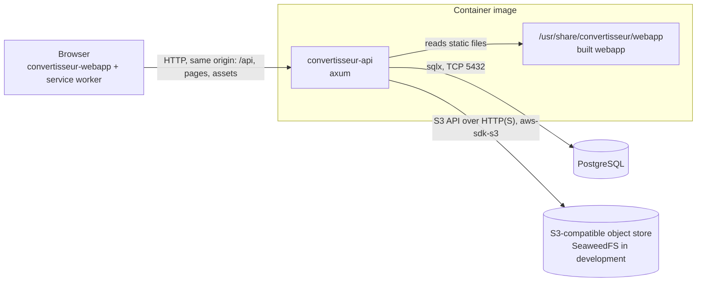
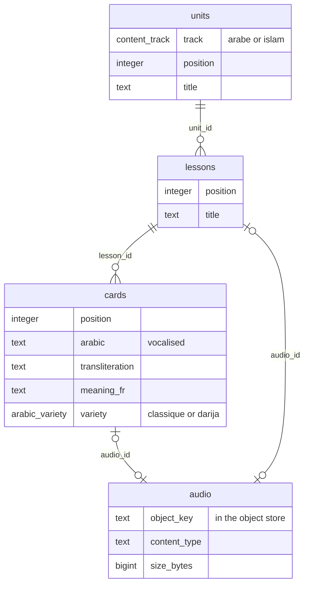
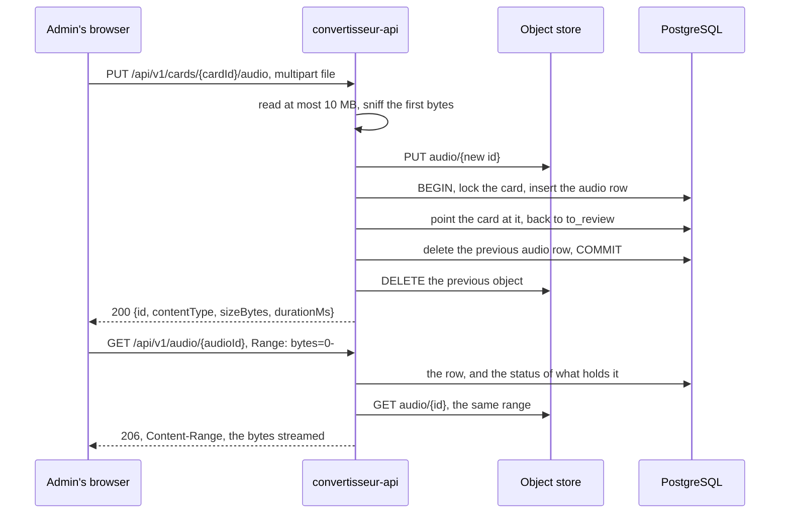
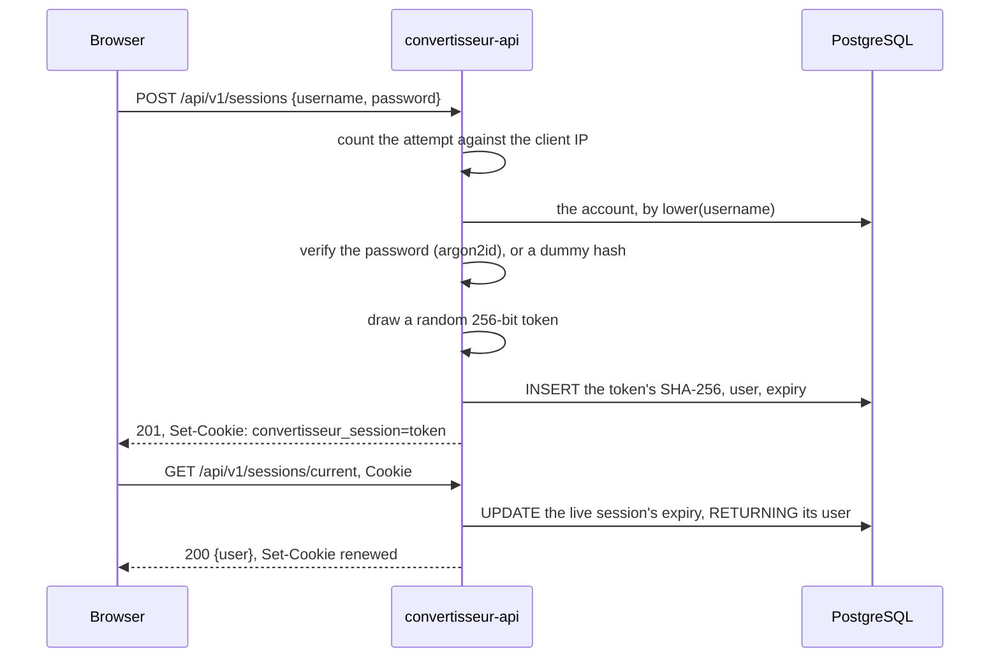
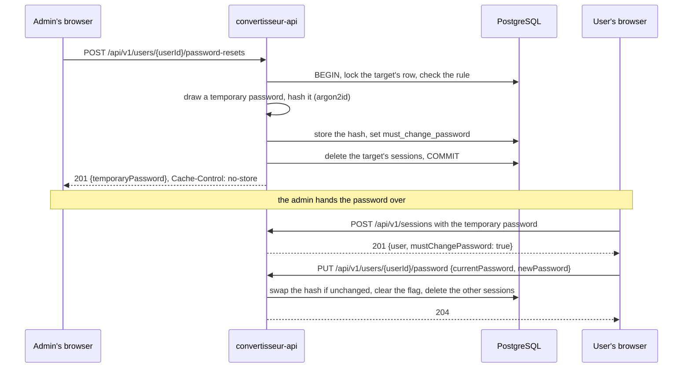
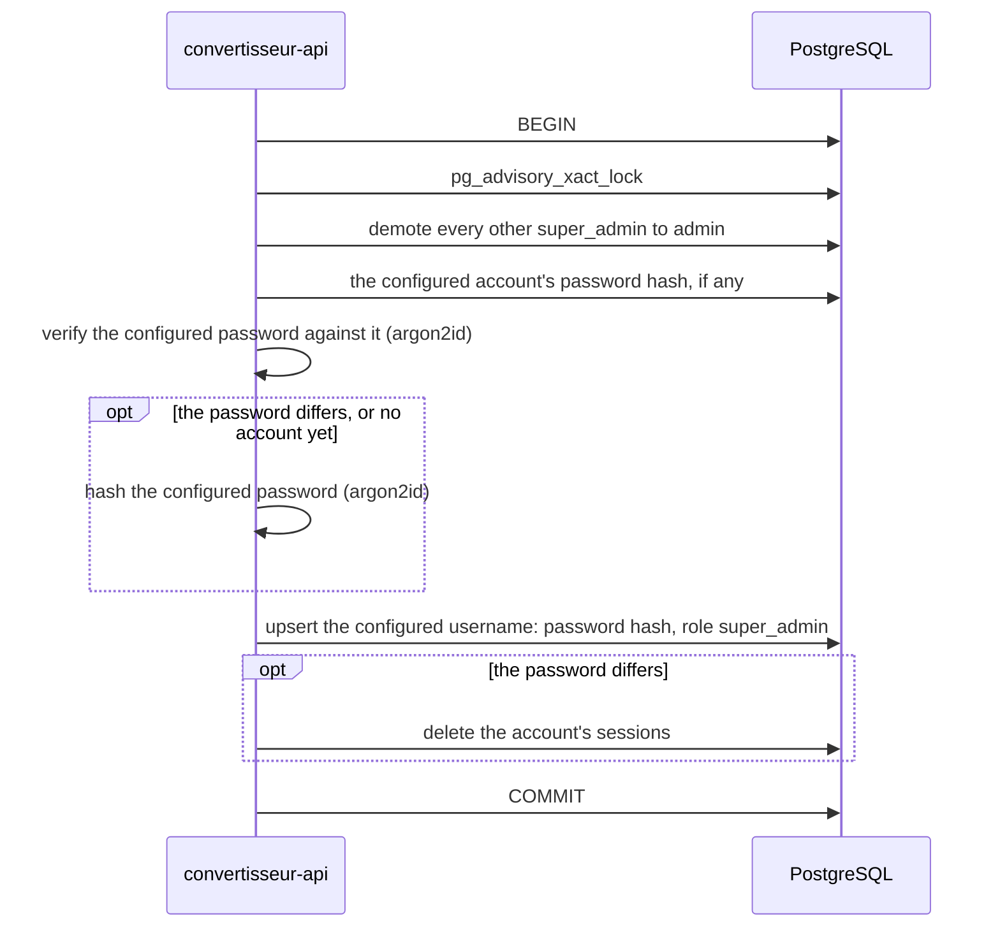

# Architecture

## Overview

Convertisseur is one HTTP server in front of a PostgreSQL database and an
S3-compatible object store. The server, [`convertisseur-api`](convertisseur-api/), answers the JSON API under
`/api` and serves the built [`convertisseur-webapp`](convertisseur-webapp/), a
React progressive web app, for every other path. Both ship in a single
container image.

## Components

### `convertisseur-api`

The Rust server: [axum](https://docs.rs/axum) with
[aide](https://docs.rs/aide) for the `OpenAPI` document, sqlx for PostgreSQL,
tokio for the runtime. One binary with two subcommands: `serve`, and
`healthcheck`, which probes `/healthz` of a server on the same host and is the
container's health check, since the runtime image has no shell or HTTP client.

On `serve`, it connects to PostgreSQL, applies the embedded migrations, runs
the super admin bootstrap, creates the object store's bucket if it does not
exist, then listens. `SIGTERM` and `SIGINT` stop it
accepting connections and let in-flight requests finish before it exits.

It owns the whole URL space, split by path:

| Path | Answered by |
| --- | --- |
| `/api/v1/…` | The JSON API, versioned in its path and built with aide so that every operation is documented. Every failure is an `application/problem+json` document. A path under `/api` that matches no operation answers a `404` problem, never the webapp. |
| `/openapi.json`, `/docs` | The `OpenAPI` document generated from the code, and the Scalar reference that renders it. |
| `/healthz`, `/readyz` | Liveness, and readiness, which runs `SELECT 1` against PostgreSQL and looks up the bucket in the object store, both at once; its `503` names what does not answer. Outside the `OpenAPI` document. |
| anything else | A file of the built webapp, or its `index.html` when no file matches, so that the client-side router resolves deep links; a missing file under `/assets` answers `404` instead. Files under `/assets` are named by Vite after their content, so they are `immutable` for a year; every other file, `index.html`, the service worker and the manifest among them, is `no-cache`, so that a browser revalidates it and picks up a new build on its next load. |

Configuration comes from flags or environment variables, parsed once by clap
in [`config.rs`](convertisseur-api/src/config.rs). SQL lives in `.sql` files
under [`queries/`](convertisseur-api/queries/), loaded with `include_str!`.

### `convertisseur-webapp`

React and TypeScript, built by Vite into static files. TanStack Router maps
paths to pages. `vite-plugin-pwa` generates the web app manifest, a Workbox
service worker that precaches the build, and the PWA icons.

Every navigation first asks the API who is logged in
(`GET /api/v1/sessions/current`): the session cookie is `HttpOnly`, so the
server is the only one that knows, and the webapp keeps no copy of the session
of its own. A visitor without a session lands on `/connexion`, the login and
registration screen; a logged-in user is sent from there to `/`. An account
whose password was reset by an admin can reach `/mot-de-passe` only, and the
admin area under `/admin` is open to `admin` and `super_admin` alone. These
guards spare the user a page that would only fail: the server enforces the
same rules on every request. The admin area opens on `/admin/contenu`, where
staff write and review the learning content, beside `/admin/utilisateurs`.

The interface is in French. The visual identity lives in CSS custom properties
in [`styles.css`](convertisseur-webapp/src/styles.css), with a light and a dark
set switched by `prefers-color-scheme`.

### `assets/`

The logo, [`logo.svg`](assets/logo.svg), and Vite's public directory: its files
are copied as-is to the root of the webapp build. The favicon and every PWA
icon are rasterised from `logo.svg` at build time.

### PostgreSQL

The store of everything structured, and the source of truth for who may read
what. The server creates and migrates its schema itself.

### Object store

Any S3-compatible service holds the bytes of uploaded media, in one bucket,
under keys the server generates; PostgreSQL holds what they belong to. Local
development and CI run [SeaweedFS](https://github.com/seaweedfs/seaweedfs) with
its S3 gateway. Browsers never reach it: the server reads an object and streams
it back after its own permission checks. The decision and its trade-offs are
recorded in
[ADR 0001](docs/adr/0001-store-media-in-an-s3-compatible-object-store.md).

The server sees it through the `ObjectStore` trait in
[`storage.rs`](convertisseur-api/src/storage.rs): check, put, get with an
optional byte range, delete. `S3Store` implements it over the S3 API;
`MemoryStore` keeps objects in a map for the tests that do not exercise S3. A
contract test runs the same checks against both, the S3 one against the
SeaweedFS of the development stack, in a throwaway bucket.

## State and persistence

Migrations live in [`convertisseur-api/migrations/`](convertisseur-api/migrations/),
are embedded in the binary with `sqlx::migrate!`, and run at every start-up;
sqlx records each one and refuses to start when an applied migration has
changed.

`users` holds the accounts: a username, unique case-insensitively through an
index on `lower(username)`; an argon2id password hash in PHC string format;
a `role` of the `user_role` enum, `user`, `admin` or `super_admin`;
`must_change_password`, set by an admin's password reset; and
`last_active_at`, the last time one of its sessions was opened or used.

`sessions` holds the logged-in sessions: the SHA-256 of the session token, the
user it belongs to, and when it expires. Deleting a user deletes its sessions.

The learning content is a tree of three tables:

- **Every unit, lesson and card carries its review**: a `status` of
  `to_review` or `validated`, `created_by` and `updated_by`, and
  `validated_by` and `validated_at` while it is validated. The author columns
  are set to `NULL` when the account is deleted; the content stays.
- **Positions are 1-based and dense among siblings**: the units of a track,
  the lessons of a unit, the cards of a lesson. A `UNIQUE (parent, position)`
  constraint, deferred to the end of the transaction, lets an insertion, a
  move or a deletion shift the siblings it passes.
- **A recording is an `audio` row**, held by one card or one lesson through
  its `audio_id`. The row holds the key of the object in the object store,
  `audio/<the row's id>`, its content type, its size, its length when known,
  and who uploaded it.
- **`content_items` is a view** over the three tables, in the shape of the
  review list: kind, track, title, parent title, status, last edit.

## Content and its review

Staff write units, lessons and cards in the admin area; a reviewer, any
`admin` or the `super_admin`, validates them. The rules, in
[`content.rs`](convertisseur-api/src/content.rs):

- **New content starts `to_review`, and any edit of its content sends it back
  there**, by whoever makes it: the `UPDATE` resets the status and the
  validation in the same statement, when a content field (title, Arabic,
  transliteration, meaning, variety, track) differs from the stored row
  (`IS DISTINCT FROM`). Saving a row unchanged keeps its validation.
  Moving or reordering a row, within its parent or to another, changes only
  its place: it keeps its status and validation, and `updated_by` and
  `updated_at` still record the move. The siblings it shifts keep their
  status.
- **Validating needs no second person.** Any admin validates, the author
  included; setting the status a row already has changes nothing, so the
  first validator and time stay.
- **Every write runs in one transaction under one advisory lock**, which
  serialises the shifting of positions across concurrent editors. Content is
  written by a few staff members, so one lock for all of it costs nothing.
- **A unit with lessons or a lesson with cards is not deleted**: the request
  answers `409` `not-empty`, and its children have to be moved or deleted
  first. A deletion never takes more than the row named.
- **The admin area is the only reader of content but recordings.** Every
  content endpoint takes `RequireRole<Admin>`; playing a recording is open to
  any logged-in account, for validated content only (see below).

The review list (`GET /api/v1/content-items`) spans the three kinds, the most
recently edited first, filtered by status, track, kind and text. Its
`statusCounts` count each status under the other filters, for the filter's
badges. The text search compares through `content_search_key`, a SQL function
that lowercases and strips the Arabic short vowels, other diacritics and the
tatweel, so `شكرا` finds `شُكْرًا`.

## Recordings

A card or a lesson holds at most one recording, uploaded as a file or
recorded with the device's microphone in the admin area, and played back
through the API.

- **No transcoding: the file is stored as the browser made it.** Safari
  records MP4 with AAC, Chrome WebM with Opus and Firefox Ogg with Opus, and
  every current browser plays all three, as well as MP3 and WAV uploads. The
  server keeps the bytes, so it needs no media toolchain and loses no quality.
- **The type comes from the file, never from the client.** The first bytes
  must be those of MP3, MP4, Ogg, WebM or WAV (see
  [`audio.rs`](convertisseur-api/src/audio.rs)), and that type is the one
  stored and served; anything else is a `415` `unsupported-audio`. The length
  is read when the file gives it cheaply, from a WAV header or the last Ogg
  page; it is `null` for the others.
- **10 MB at most**, set by a body limit on the upload routes alone, a little
  above the file limit to leave room for the multipart framing, then checked
  on the file itself; past it, a `413` `too-large`.
- **No object without a purpose is left behind, and no row without its
  object.** The new object is written before the row that points at it and
  deleted again if the transaction fails; the previous object is deleted only
  after the commit that stops pointing at it. Removing a recording, or
  deleting the card or lesson that holds it, deletes the row and then the
  object. A failed object deletion leaves an orphan that nothing references
  and logs a warning; it never fails the request.
- **A new or removed recording is an edit**: the card or lesson goes back to
  `to_review`.
- **Playback goes through the API** (`GET /api/v1/audio/{audioId}`), which
  streams the object from the store. Any logged-in account plays the
  recording of validated content, an `admin` plays any; anything else is a
  `404`, which says nothing of what exists. It honours a single
  `Range: bytes=…` with a `206`, which Safari needs to seek in an `<audio>`
  element, answers `Cache-Control: private`, and sends the stored type with
  `X-Content-Type-Options: nosniff`.
- **The microphone needs a secure context.** Browsers open it only on HTTPS
  pages, and on `http://localhost`. On anything else the admin area says so
  and offers the file upload; the same goes for a browser without
  `MediaRecorder` or a refused permission.

## Accounts and sessions

An account is a username and a password, with no email address. Registration
creates a `user`; usernames are 3 to 32 characters among ASCII letters, digits,
`.`, `_` and `-`, and passwords at least 12 characters, the rule the super
admin's password follows too. Registering does not log in: the webapp chains
the two calls.

- **The browser holds an opaque token; the database holds its SHA-256.** The
  token is 32 random bytes, so a fast hash is enough, and a copy of the table
  yields nothing that can be replayed as a cookie.
- **A session lasts 30 days after its last use.** Each authenticated request
  moves the expiry 30 days ahead and renews the cookie's `Max-Age` to match.
  An expired session is refused at once, and an hourly task in the server
  deletes the expired rows.
- **Logout deletes the session** and clears the cookie. It answers `204`
  whether or not there was a session, so a retry is harmless.
- **A new super admin password closes that account's sessions.** The bootstrap
  verifies the configured password against the stored hash; when it no longer
  matches, it stores the new hash and deletes the account's sessions in the
  same transaction. The same password keeps the stored hash and the sessions,
  so a restart logs nobody out.
- **A failed login says nothing about the username.** An unknown username and a
  wrong password get the same `401`, and an unknown username is verified
  against a fixed dummy hash, with the same argon2 parameters, so that both take
  as long.
- **Login and registration are rate limited per client IP**: 10 login attempts
  at once then one a minute, and 5 registrations at once then one every 10
  minutes. A refusal is a `429` problem with `Retry-After`. The client IP is
  the TCP peer, or the last address in the header named by `CLIENT_IP_HEADER`
  when the server sits behind a reverse proxy that sets it.

## Roles and permissions

Three roles, in increasing order of power: `user`, `admin`, `super_admin`.

| Action | `admin` | `super_admin` |
| --- | --- | --- |
| Open the admin area, list and search accounts | yes | yes |
| Reset the password of, or delete, a `user` | yes | yes |
| Reset the password of, or delete, an `admin` | no | yes |
| Change a role between `user` and `admin` | no | yes |
| Write, validate and delete learning content | yes | yes |

The rule behind the table, in
[`users::may`](convertisseur-api/src/users.rs): an account manages only
accounts of a lower role, and only the super admin changes roles. Two
exceptions win over it: nobody acts on the super admin, which exists only
through the configuration, and nobody acts on their own account from the
admin area. A refusal is a `403` `forbidden` problem.

The server checks this on every request, in two places:

- **A role guard on the endpoint.** The `RequireRole` extractor in
  [`extract.rs`](convertisseur-api/src/api/extract.rs) refuses an account
  below the endpoint's least role before the handler runs: `admin` for the
  listing, the reset, the deletion and every content endpoint, `super_admin`
  for a role change.
- **The rule on the target**, in
  [`accounts.rs`](convertisseur-api/src/accounts.rs), inside the transaction
  that acts: the target's row is locked with `SELECT … FOR UPDATE`, so its
  role cannot change between the check and the action.

The role is read from the database on every request, with the session, so a
new role applies to the account's open sessions at once.

## Password resets

Accounts have no email address, so a forgotten password goes through an admin:

- **The temporary password exists once, in the response.** The server keeps
  only its hash and logs neither it nor its length. It is 20 characters drawn
  from 31 lowercase letters and digits with no look-alikes (no `0`/`o`,
  `1`/`l`/`i`), in groups of five, so that it survives being read out or
  copied by hand.
- **Until the change, the account can do nothing else.** Every endpoint but
  the password change, the current session and logout takes the
  `Authenticated` extractor, which answers a `403` `password-change-required`
  problem; the session payload carries `mustChangePassword`, and the webapp
  keeps the account on `/mot-de-passe`.
- **The temporary password works until it is replaced.** It is the account's
  password in every respect but the flag, so a login with it can be repeated
  until the change succeeds; after that it matches nothing.

Any account changes its own password the same way, with
`PUT /api/v1/users/{userId}/password`, which accepts only the session's own
account. It checks the current password and counts against the login rate
limit, so a stolen session cannot be used to guess it. On success, the
account's other sessions are closed and the current one is kept. The new hash
replaces the old one only if the old one is still stored, so two concurrent
changes cannot both succeed.

## The super admin bootstrap

At every start-up, the server makes the account named by
`--super-admin-username` the one and only super admin, in one transaction:

- The password is re-applied on every start-up, so rotating it is a
  configuration change and a restart, which also logs the super admin out
  everywhere.
- Renaming the super admin in the configuration demotes the previous one to
  `admin` instead of leaving a second super admin behind.
- The advisory lock serialises replicas starting at the same time.
- Demotion runs before the upsert because a partial unique index allows at most
  one `super_admin` row at any point in the transaction.

## Design decisions

**One image serves the API and the webapp.** The browser talks to a single
origin, so there is no CORS to configure and no proxy to keep in step with the
API's paths, and a deployment is one artefact at one version. The price is that
static files go through the Rust server rather than a dedicated web server or a
CDN; for an app this size, a precached PWA, that load is negligible.

**The documentation endpoints sit at the root, not under `/api`.**
`/openapi.json` and `/docs` keep fixed, well-known paths, the same on any API,
rather than moving with the API's own prefix. The webapp therefore never routes
them, and the service worker leaves them, like `/api`, to the network.

**Sessions live in PostgreSQL rather than in a signed token.** A server-side
session can be deleted: logout, an expiry and a password change take effect on
the next request, which a self-contained token such as a JWT cannot do without
a revocation list that is a session table under another name. The price is a
database round trip on every authenticated request, which the one database this
app already depends on absorbs easily.

**The session travels in a cookie, not in an `Authorization` header.** An
`HttpOnly` cookie is out of reach of the page's JavaScript, so a script injected
into the webapp cannot read the token, where a token kept in `localStorage`
could be stolen. The cookie is `SameSite=Lax`, `Path=/`, with no `Domain`, and
`Secure` unless `COOKIE_SECURE` turns it off for plain-HTTP development. Its
name, `convertisseur_session`, is the app's own, because browsers share
cookies across the ports of one host and a generic name collides with other
apps on `localhost`.

**Cross-site request forgery is stopped by `SameSite=Lax` and JSON-only
bodies, without tokens.** A `Lax` cookie is not sent on a cross-site `POST`,
`PUT` or `DELETE`, and every endpoint with a body refuses any content type but
`application/json` with a `415`, which an HTML form cannot send and a
cross-origin `fetch` cannot send without a CORS preflight that the server never
grants. The one exception, the recording upload, takes `multipart/form-data`,
which a form can send, but only with `PUT`, which a form cannot. The endpoints without a body, logout, account deletion and password
reset, rest on `SameSite=Lax` alone: an HTML form cannot send a `DELETE`, and
the browser keeps the cookie off a cross-site form `POST`. A `GET` changes nothing but the expiry of the caller's own session, so
the top-level navigations `Lax` still lets the cookie through on are harmless.

**Rate limits are counted in memory, per process.** They need no shared store,
and they hold a brute force to a few thousand guesses a day per address, on
passwords of at least 12 characters. The cost is that each replica counts on
its own and a restart forgets the counts.

**Last activity lives on the account, not in `sessions`.** Logout, expiry,
a password change and a reset all delete sessions, and the admin area must
still say when the account was last seen. The cost is a second row written on
each authenticated request, in the same statement that slides the session.

**An account forced to change its password is refused with a `403`, not a
`401`.** It is logged in, and a `401` would tell the webapp to send it back to
the login screen; the dedicated problem type tells it where to go instead.

**The admin area lists accounts by role, then by username**, the super admin
first. A listing that puts the accounts with the most power on top is the
one an admin reads most often; usernames sort byte-wise on their lowercase
form, which is stable across database locales.

**The S3 client is `aws-sdk-s3`.** It speaks the whole S3 API, so the server
can look up and create its bucket at start-up and send byte-range reads, and
it is the reference implementation every S3-compatible store tests against.
`object_store`, the lighter alternative, has no bucket operations. The price
is a large dependency tree and a longer first build. Its HTTP client is built
on rustls with the `ring` provider, the one the rest of the server already
uses, rather than the SDK's default `aws-lc-rs`, which needs a C toolchain and
CMake.

**The server creates its bucket, rather than the deployment.** On start-up it
looks the bucket up and creates it only when the store answers that it does
not exist, so development, CI and tests need no setup step, and a production
bucket provisioned beforehand works with credentials that cannot create one.

**The storage implementations are chosen by an enum, `Storage`**, rather than
by a type parameter on `AppState`: handlers and extractors stay non-generic,
and dispatch stays static.

**The review list is one collection over three tables.** Reviewers read the
units, lessons and cards to review as one queue, ordered by their last edit,
so `content-items` is a read-only collection backed by a `UNION ALL` view;
each kind keeps its own collection (`/units`, `/lessons`, `/cards`) for
reading one item and writing. The review status is a state of the item, set
with `PUT …/status`, rather than an action endpoint.

**Environment variables have bare names**, such as `BIND_ADDR` or
`SUPER_ADMIN_PASSWORD`. The server runs in a container whose environment is
written for it alone, so a prefix would only be noise. `DATABASE_URL` is the
standard name, which sqlx's test harness reads too, so one variable serves the
server and the tests. The object store's settings share an `S3_` prefix, which
names the protocol they configure; the `AWS_` names are left alone because the
store need not be AWS.

**Fonts are self-hosted.** Nunito and Amiri come from Fontsource packages and
ship in the build, so the installed app renders offline and no font request
leaves for a third party. Amiri is only downloaded when a page shows Arabic.

**Icons are generated, not committed.** The build rasterises `logo.svg` into
the favicon, the PWA icons and the Apple touch icon, so there is one logo file
and no raster that can drift from it.

## Invariants and constraints

- **Exactly one super admin**, the account named in the configuration, after
  every successful start-up. The database guarantees at most one; the
  bootstrap guarantees at least one.
- **The object store's secret key never reaches a log.** clap hides its
  environment value from `--help`, the configuration types do not implement
  `Debug`, and the SDK redacts credentials in its own output.
- **The super admin password never reaches a log.** clap hides its environment
  value from `--help`, the configuration types do not implement `Debug`, and
  only its hash is stored.
- **Usernames are unique regardless of case.** The bootstrap and the login
  match a username case-insensitively, and keep the stored spelling.
- **A session token never reaches the database or a log.** Only its SHA-256 is
  stored, and no log line carries a token or a password, temporary passwords
  included.
- **The super admin is changed only through the configuration.** No endpoint
  resets its password, deletes it or changes its role, and the bootstrap
  clears any pending forced change on it.
- **Permissions are enforced by the server.** The webapp hides what the
  server would refuse, and nothing more.
- **The configured super admin's username is not reserved.** It exists from
  the first start-up, so registering it answers the same `409` as any other
  taken username. Its format is exempt from the registration rules.
- **Arabic text is always `lang="ar"` and `dir="rtl"`**, which the
  [`Arabic`](convertisseur-webapp/src/components/Arabic.tsx) component sets
  together; `:lang(ar)` sets it in Amiri.
- **Gold (`--color-accent`) is never thin text on cream**: it fails contrast
  there. It fills surfaces and accents; text on it uses
  `--color-on-accent-soft`.

## Limitations

- Accounts have no email address, so there is no self-service password reset:
  an admin resets a forgotten password and hands the temporary one over.
- The rate limits key on an IP address: people behind one NAT, a school or a
  mosque network, share their limits.
- The server does not start when PostgreSQL or the object store is
  unreachable: it exits, and the orchestrator restarts it.
- The object store's credentials are a static access key pair; instance
  roles and web identity federation are not supported.
- The theme follows the operating system's light or dark preference; the app
  has no theme setting of its own.
- The content forms offer the 100 most recently edited units, or lessons, as
  the parent of a new lesson or card.
- A recording's length is known for WAV and Ogg files only; the others would
  need their whole stream parsed.
