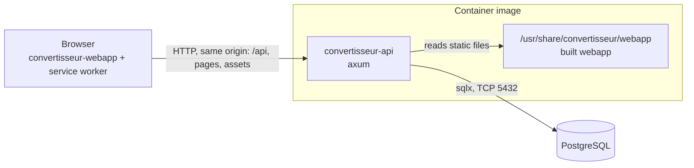
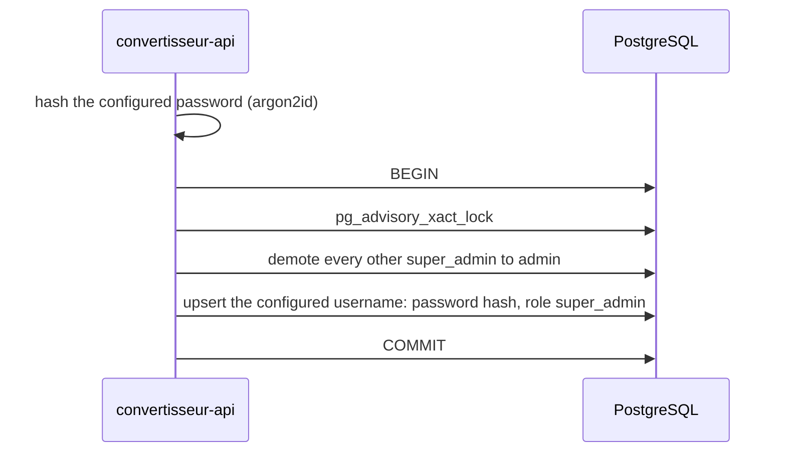

# Architecture

## Overview

Convertisseur is one HTTP server in front of one PostgreSQL database. The
server, [`convertisseur-api`](convertisseur-api/), answers the JSON API under
`/api` and serves the built [`convertisseur-webapp`](convertisseur-webapp/), a
React progressive web app, for every other path. Both ship in a single
container image.

## Components

### `convertisseur-api`

The Rust server: [axum](https://docs.rs/axum) with
[aide](https://docs.rs/aide) for the `OpenAPI` document, sqlx for PostgreSQL,
tokio for the runtime. One binary with two subcommands: `serve`, and
`healthcheck`, which probes `/healthz` of a server on the same host and is the
container's health check, since the runtime image has no shell or HTTP client.

On `serve`, it connects to PostgreSQL, applies the embedded migrations, runs
the super admin bootstrap, then listens. `SIGTERM` and `SIGINT` stop it
accepting connections and let in-flight requests finish before it exits.

It owns the whole URL space, split by path:

| Path | Answered by |
| --- | --- |
| `/api/…` | The JSON API, built with aide so that every operation is documented. A path under `/api` that matches no operation answers a `404` `application/problem+json`, never the webapp. |
| `/openapi.json`, `/docs` | The `OpenAPI` document generated from the code, and the Scalar reference that renders it. |
| `/healthz`, `/readyz` | Liveness, and readiness, which runs `SELECT 1` against PostgreSQL. Outside the `OpenAPI` document. |
| anything else | A file of the built webapp, or its `index.html` when no file matches, so that the client-side router resolves deep links. |

Configuration comes from flags or environment variables, parsed once by clap
in [`config.rs`](convertisseur-api/src/config.rs). SQL lives in `.sql` files
under [`queries/`](convertisseur-api/queries/), loaded with `include_str!`.

### `convertisseur-webapp`

React and TypeScript, built by Vite into static files. TanStack Router maps
paths to pages. `vite-plugin-pwa` generates the web app manifest, a Workbox
service worker that precaches the build, and the PWA icons.

The interface is in French. The visual identity lives in CSS custom properties
in [`styles.css`](convertisseur-webapp/src/styles.css), with a light and a dark
set switched by `prefers-color-scheme`.

### `assets/`

The logo, [`logo.svg`](assets/logo.svg), and Vite's public directory: its files
are copied as-is to the root of the webapp build. The favicon and every PWA
icon are rasterised from `logo.svg` at build time.

### PostgreSQL

The only store. The server creates and migrates its schema itself.

## State and persistence

Migrations live in [`convertisseur-api/migrations/`](convertisseur-api/migrations/),
are embedded in the binary with `sqlx::migrate!`, and run at every start-up;
sqlx records each one and refuses to start when an applied migration has
changed.

`users` holds the accounts: a username, unique case-insensitively through an
index on `lower(username)`; an argon2id password hash in PHC string format;
and a `role` of the `user_role` enum, `user`, `admin` or `super_admin`.

## The super admin bootstrap

At every start-up, the server makes the account named by
`--super-admin-username` the one and only super admin, in one transaction:

- The password is re-applied on every start-up, so rotating it is a
  configuration change and a restart.
- Renaming the super admin in the configuration demotes the previous one to
  `admin` instead of leaving a second super admin behind.
- The advisory lock serialises replicas starting at the same time.
- Demotion runs before the upsert because a partial unique index allows at most
  one `super_admin` row at any point in the transaction.

## Design decisions

**One image serves the API and the webapp.** The browser talks to a single
origin, so there is no CORS to configure and no proxy to keep in step with the
API's paths, and a deployment is one artefact at one version. The price is that
static files go through the Rust server rather than a dedicated web server or a
CDN; for an app this size, a precached PWA, that load is negligible.

**The documentation endpoints sit at the root, not under `/api`.**
`/openapi.json` and `/docs` keep fixed, well-known paths, the same on any API,
rather than moving with the API's own prefix. The webapp therefore never routes
them, and the service worker leaves them, like `/api`, to the network.

**Environment variables have bare names**, such as `BIND_ADDR` or
`SUPER_ADMIN_PASSWORD`. The server runs in a container whose environment is
written for it alone, so a prefix would only be noise. `DATABASE_URL` is the
standard name, which sqlx's test harness reads too, so one variable serves the
server and the tests.

**Fonts are self-hosted.** Nunito and Amiri come from Fontsource packages and
ship in the build, so the installed app renders offline and no font request
leaves for a third party. Amiri is only downloaded when a page shows Arabic.

**Icons are generated, not committed.** The build rasterises `logo.svg` into
the favicon, the PWA icons and the Apple touch icon, so there is one logo file
and no raster that can drift from it.

## Invariants and constraints

- **Exactly one super admin**, the account named in the configuration, after
  every successful start-up. The database guarantees at most one; the
  bootstrap guarantees at least one.
- **The super admin password never reaches a log.** clap hides its environment
  value from `--help`, the configuration types do not implement `Debug`, and
  only its hash is stored.
- **Usernames are unique regardless of case.** The bootstrap matches the
  configured username case-insensitively, and keeps the stored spelling.
- **Arabic text is always `lang="ar"` and `dir="rtl"`**, which the
  [`Arabic`](convertisseur-webapp/src/components/Arabic.tsx) component sets
  together; `:lang(ar)` sets it in Amiri.
- **Gold (`--color-accent`) is never thin text on cream**: it fails contrast
  there. It fills surfaces and accents; text on it uses
  `--color-on-accent-soft`.

## Limitations

- The server does not start when PostgreSQL is unreachable: it exits, and the
  orchestrator restarts it.
- The theme follows the operating system's light or dark preference; the app
  has no theme setting of its own.
