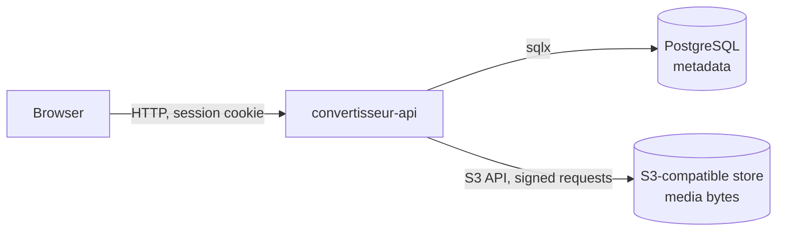

# 0001. Store uploaded media in an S3-compatible object store

- **Status**: accepted
- **Date**: 2026-11-08

## Context

The staff who write lessons record or upload audio: the pronunciation of a
word, a verse recited in the Warsh reading. These files are a few hundred
kilobytes to a few megabytes each, written once, read by every learner who
reaches the card, and never edited in place. Images and other media are likely
to follow the same path.

Until now the server has had one store, PostgreSQL, and one container image,
which keeps no state of its own and may run as several replicas. Audio is
learning content that is reviewed before learners see it, so who may read a
file depends on the state of the content it belongs to.

## Decision

We store uploaded media in an S3-compatible object store, in one bucket, under
keys the server generates. PostgreSQL keeps the metadata (the key, the content
type, the size, the content the file belongs to) and remains the source of
truth for who may read what.

The server talks to the store with the S3 API only, through an endpoint, a
region, a bucket and an access key pair taken from its configuration, so any
S3-compatible service will do. Local development and CI run SeaweedFS with its
S3 gateway.

Browsers never talk to the store: the API reads an object and streams it back,
after the same session and permission checks as any other request.

## Consequences

- The image stays stateless and replicas share the media, as they share the
  database.
- Media bytes stay out of PostgreSQL, so its size, backups and restores stay
  proportional to the structured data.
- Every read goes through the API. Permissions and the review status apply to
  files with no second mechanism to keep in step, at the cost of the server's
  bandwidth and a connection held for the length of each download. Public or
  presigned URLs would offload that, but a link handed out cannot be revoked
  when the content goes back to review.
- There are two stores to back up, and they must be restored together: a
  database restored without its objects points at missing files, objects
  restored without their rows are orphans nothing references.
- A write touches both stores without a shared transaction, so the server must
  order its writes so that a failure leaves an orphaned object at worst, never
  a row pointing at nothing, and must delete the object it replaces.
- The server cannot start without the object store, and readiness depends on
  it: one more dependency to run in development, CI and production.

## Alternatives considered

- **`bytea` columns in PostgreSQL**: one store and transactional writes, but
  every megabyte of audio inflates the database, its WAL and its backups, and
  a large value is read whole into memory, which makes byte-range requests
  for seeking costly.
- **Files on a local filesystem or volume**: the simplest to write, but it
  ties the data to one host or one volume, which breaks running several
  replicas and leaves backups to whatever the host provides.
